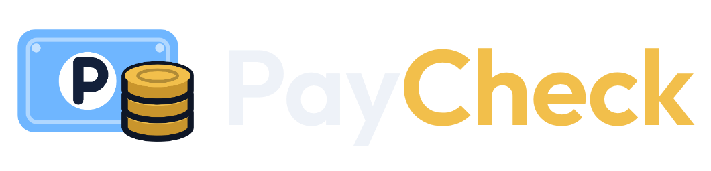

<p align="center">
  <picture>
    <source media="(prefers-color-scheme: dark)" srcset="logo/paycheck-wordmark-on-dark-256.png">
    
  </picture>
</p>

# PayCheck

A personal budgeting app built around one idea: every paycheque gets split up front. You give yourself a set amount to spend per category, and the rest goes straight into savings (TFSA, a regular savings account, or both).

It has five tabs. Tap them in the bar at the bottom, or swipe left and right:

- **Payday**: type in what you got paid and it shows where every dollar goes, and the transfers to make.
- **Spending**: log purchases and see what's left in each spending limit until payday.
- **Goals**: savings goals with a target and date, how often you're paid, and your spending limits.
- **Accounts**: your accounts and debts, net worth, sync, and backups of your data.
- **History**: each pay period, which limits you kept, what you saved, and how each goal is pacing.

There's no bank connection; you type amounts in. Your data is saved on your device, and can sync between your devices if you sign in.

## What you need

- A Mac with **Node.js** installed (the LTS version from [nodejs.org](https://nodejs.org)). Check with `node -v` in Terminal.
- An iPhone with **Expo Go** from the App Store.
- A free **Expo account** from [expo.dev](https://expo.dev), for putting the app on your home screen.

## 1. Get the code and install

In Terminal:

```bash
git clone https://github.com/Lem-D/PayCheck.git
cd PayCheck/mobile
npm install
```

If you already have the code, go to the folder and get the latest instead:

```bash
cd PayCheck
git pull
cd mobile
npm install
```

Every command below runs in `PayCheck/mobile`. Your Terminal prompt should end in `mobile %`.

## 2. Try it in Expo Go

```bash
npm start
```

A QR code appears. Scan it with your iPhone's camera and it opens in Expo Go. Your iPhone and Mac need to be on the same Wi-Fi; if they aren't, or it won't connect, stop it with `Control + C` and run `npx expo start --tunnel` instead.

When you save a change to the code, the app on your phone reloads on its own. Expo Go only works while `npm start` is running on your Mac, so it's best for trying changes.

## 3. Put it on your iPhone home screen

This makes PayCheck open from its own icon, full screen, even when your Mac is off. It's free and doesn't expire.

1. Sign in to Expo once:
   ```bash
   npx eas-cli@latest login
   ```
2. Publish it:
   ```bash
   npm run deploy:web
   ```
   The first time, say yes to creating the project and pick a name for the address, such as `paycheck`. The app then lives at `https://paycheck.expo.app` (the address is printed at the end, and shown on expo.dev under the project's Hosting page). This also adds the project's id to `app.json`, so commit that.
3. On your iPhone, open that address in **Safari**, tap the **Share** button, then **Add to Home Screen**, then **Add**.

To publish a change later, run `npm run deploy:web` again. The home screen app picks it up the next time you open it.

## Your data and backups

Your numbers are saved on the device you entered them on. Expo Go, the home screen app and Safari each keep their own copy, unless you turn on sync (below).

To keep a copy safe, or move your numbers from one to another, go to the bottom of the **Accounts** tab:

- **Save a backup** saves everything to one file. On the iPhone it opens the share sheet, so pick **Save to Files** (iCloud Drive is a good place).
- **Restore from a backup** opens that file and replaces what's in the app, after asking you to confirm.

The app shows when you last saved a backup, and turns that line yellow after 30 days. If you delete the home screen icon, its data goes with it, so back up first.

## Sync between devices

Sign in once and your numbers stay the same in Expo Go, the home screen app and on your other devices. It uses Firebase, which is free for this. You set it up once:

1. Go to [console.firebase.google.com](https://console.firebase.google.com), sign in with a Google account, and click **Create a project**. Name it `PayCheck`, turn off Google Analytics, and create it.
2. In the menu, open **Build → Authentication**, click **Get started**, choose **Email/Password**, switch on the first option, and click **Save**.
3. Open **Build → Firestore Database**, click **Create database**, pick a location near you (such as `northamerica-northeast1 (Montréal)`), choose **Start in production mode**, and create it.
4. In Firestore, open the **Rules** tab, replace everything there with the contents of [`mobile/firestore.rules`](mobile/firestore.rules), and click **Publish**. These keep your data private to your account.
5. Click the gear next to **Project Overview**, then **Project settings**. Under **Your apps**, click the web icon (`</>`), name it `PayCheck`, and click **Register app** (leave Firebase Hosting off). Copy the `firebaseConfig` it shows.
6. Open `mobile/src/lib/sync/config.ts` and replace `null` with the `{ ... }` part you copied, so it reads `export const firebaseConfig: FirebaseOptions | null = { apiKey: "...", ... };`. These values aren't secret, so it's fine to commit them.
7. In `mobile`, run `npm install`, then `npm run deploy:web` to update the home screen app. Restart `npm start` for Expo Go.

Then, in the app, open the **Accounts** tab and scroll to **Sync**:

- On the device that has your numbers, type an email and password and tap **Create account**.
- On each other device, tap **Sign in** with the same email and password.

If a device already has different numbers from your account, it asks which to keep. Changes show up on your other devices within a few seconds, and changes made offline are sent when you're back online. If two devices change the same thing, the newest change wins; purchases logged on both are all kept. **Forgot password?** emails you a reset link. **Sign out** stops syncing and leaves your numbers on that device.

## Commit your changes

The app's code and settings live in this repo, so commit after changing them (for example after the first `deploy:web`):

```bash
cd ..            # back to the PayCheck folder
git add -A
git commit -m "Describe what changed"
git push
```

## Troubleshooting

| What you see | What to do |
| --- | --- |
| `Missing script: "deploy:web"` or `"start"` | You're in the `PayCheck` folder. Run `cd mobile` first. |
| `command not found: npm` or `node` | Install Node.js from [nodejs.org](https://nodejs.org), then open a new Terminal window. |
| `command logi not found` (or another typo) | Check the spelling: it's `npx eas-cli@latest login`. |
| The QR code doesn't open the app | Make sure both are on the same Wi-Fi, or use `npx expo start --tunnel`. |
| Expo Go says the project needs a newer version | Update Expo Go from the App Store. |
| Something breaks right after `git pull` | Run `npm install` again in `mobile`, since new packages may have been added. |
| No **Sync** section on the Accounts tab | The Firebase settings aren't in `mobile/src/lib/sync/config.ts` yet. See "Sync between devices". |
| Sync says it couldn't reach your account | Check your internet connection and tap **Try again**. If it still fails, check the Firestore rules were published (step 4). |
| Long lists of `npm warn deprecated` | Safe to ignore. |

## Other ways to run it

- **In a browser on your Mac:** `npm run web`.
- **As an installed app with EAS Build:** `npm run build:ios` makes a real iPhone app, but needs the Apple Developer Program ($99 a year). `npm run build:android` makes a free Android app. See [mobile/README.md](mobile/README.md#installing-it-for-real).

## For developers

```bash
npm test           # unit tests: payday allocation, spending, history, backups and sync
npm run typecheck  # TypeScript
npm run build:web  # build the home screen version into dist/ without publishing
```

[mobile/README.md](mobile/README.md) has the code layout, and [DESIGN.md](DESIGN.md) has the data model, storage and screens.

## What's in this repo

- **`mobile/`**: the PayCheck app (Expo and React Native). This is where new work goes.
- **`logo/`**: logo PNGs in light and dark at several sizes. See [logo/README.md](logo/README.md).
- **`mockups/`**: the colour, layout and logo options that were tried, the Harbour Gold design that was picked, and the logo SVGs in `mockups/logo/`. See [mockups/README.md](mockups/README.md).
- **`index.html`**: the original single-page prototype. Open it in a browser and it works on its own. The hosted version, [Paycheque Plan](https://claude.ai/artifact/9oKM98u3YgoHKojCjcB5Ae), also syncs across devices.

## Plan

1. **Accounts and debts** (done). Each account (chequing, savings, TFSA, RRSP, FHSA) with its balance, plus anything you owe. Shows your net worth at a glance.
2. **Payday from goals** (done). What you got paid goes to spending limits first, then what each goal needs to hit its date, then leftovers to the goal or account you pick.
3. **Track spending against your limits** (done). Log purchases as they happen; each limit turns yellow and red as you get close.
4. **Habit tracking** (done). A history per pay period of the limits you kept, what you saved, and how each goal is tracking.
5. **Sync between devices** (done). Sign in once and your numbers stay the same on every device, without backup files.
